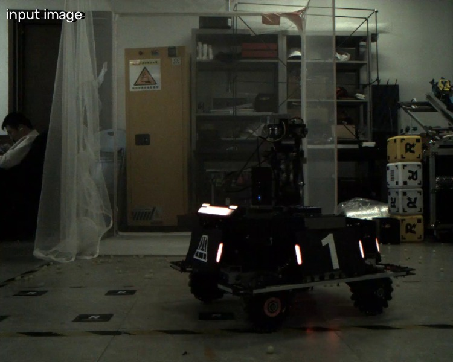
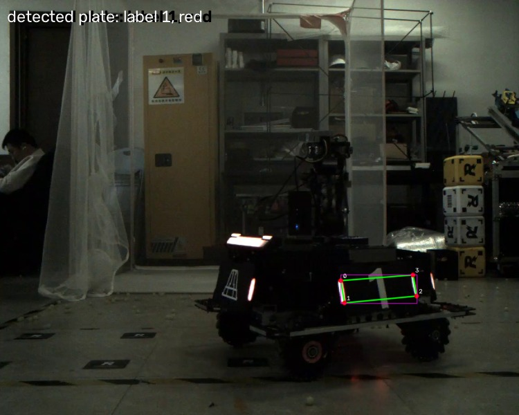
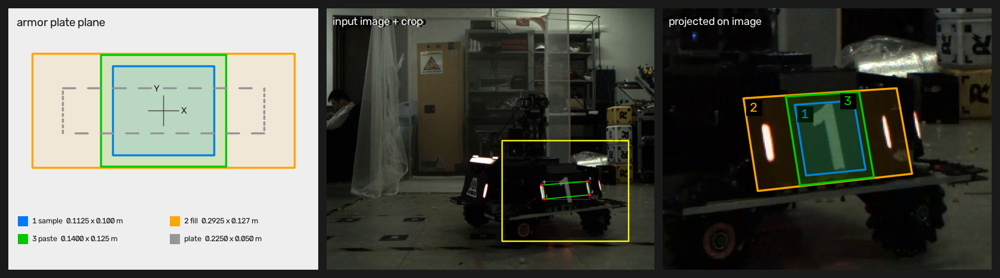
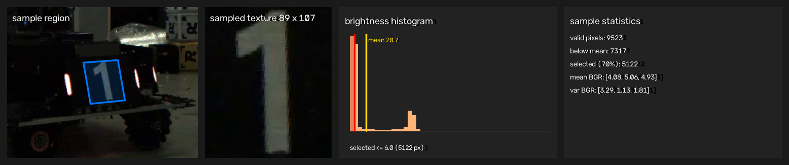
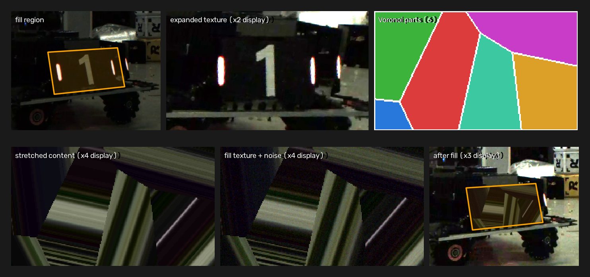
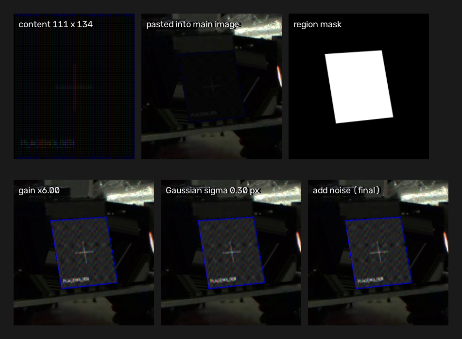
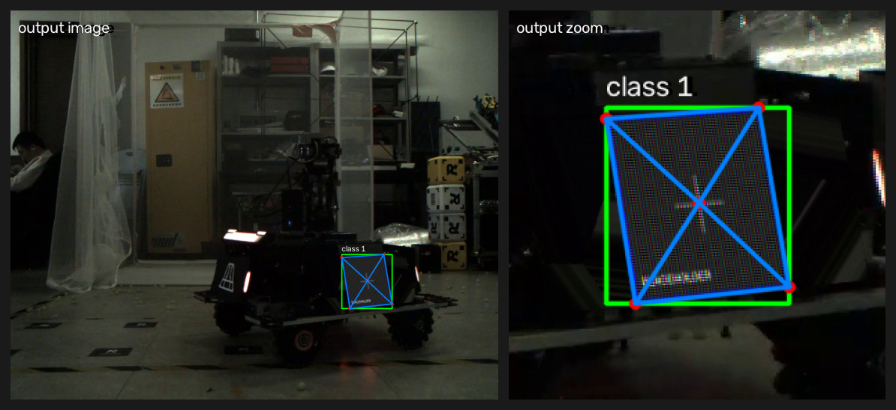

# ArmorDatasetConverter

把输入图片里的装甲板替换成合成内容，生成 YOLO-Pose 数据集。

## 处理流程

1. 可选：用 `assets/dot_matrix/dot_matrix.py` 把图片渲染成 LED 点阵屏，模拟屏幕的子像素结构和摩尔纹。
2. 主流程：`main.py` 检测装甲板，在装甲板平面内构造三个同心矩形，完成采样、填充和贴图，写出 YOLO-Pose 数据集。
3. 查看：`visualize_dataset.py` 读取生成的数据集，逐张绘制物体框、关键点和骨架。

### 可选：图片点阵屏化

`assets/dot_matrix/dot_matrix.py` 把 `assets/dot_matrix/input/` 里的图片批量渲染成点阵屏外观，结果输出到 `assets/dot_matrix/output/`。这一步是可选的；需要模拟屏幕拍摄和摩尔纹时再使用。

处理步骤：

1. 读取输入图片，用 `INTER_AREA` 缩小到 `ROWS x COLS`（当前为 64x64）的点阵分辨率。
2. 从 `assets/dot_matrix/masks/` 读取每个颜色通道的单个 cell 蒙版（16x16 灰度 PNG，当前使用 `stripe` 布局），再缩放到当前 cell 尺寸。
3. 把单个 cell 蒙版平铺到全部点阵像素，按 B/G/R 通道分别填充颜色。
4. 把 `uint8` 转成 `float32`，乘以增益 `GAIN`（当前 4.0），让高光部分超过 255。
5. 做高斯模糊（`SIGMA=0.15` 个 cell 边长）模拟发光，再截断到 `[0,255]` 并转回 `uint8`。
6. 输出同名 PNG 到 `assets/dot_matrix/output/`。

点阵屏的每个 cell 由 RGB 子像素条纹组成；图片经过缩放、旋转或透视采样后，周期性子像素结构会产生摩尔纹和彩色纹理。把点阵屏化后的图片放进 `input/` 再运行主流程，可以让数据集覆盖屏幕拍摄和摩尔纹场景。本项目配置里使用的 `assets/placeholder_t*_dot.png` 与该脚本输出的图片内容相同。

### 主处理流程

`main.py` 逐张处理 `input/` 里的图片；每张图里的每个装甲板执行以下步骤。

下面的示意图使用 `input/video_hero_red_f001503.jpg`，该图检测到 1 块装甲板（label 1，红色）。



1. **检测装甲板**：`armor/detector.py` 用 `models/0726.onnx` 推理。图片先做 letterbox 缩放和灰边填充到高 480、宽 640，再转成 RGB/255 张量；模型输出 21 个通道、6300 个候选，通道 0~3 是颜色分数，4~12 是 9 个类别分数，13~20 是四个关键点的坐标。解码时对类别和颜色取最大值，按置信度 0.65 过滤，把关键点从 letterbox 坐标还原到原图，取四个关键点的外接矩形做 NMS（阈值 0.45）。单阶段四关键点模型一次给出类别、颜色和四个角点，后续求单应不需要额外的框回归分支；每块装甲板因此得到四个角点像素、类别 0~8 和颜色（当前主流程只保留模型颜色 0 和 1，即蓝色和红色）。

   

2. **求装甲板平面的单应矩阵**：按类别选择大装甲板（label 1、8，真实尺寸 0.225x0.050 米）或小装甲板（label 0、2~7，真实尺寸 0.133x0.050 米）。把四个角点与平面坐标（原点在板中心，X 向右、Y 向上）对应，做四点 DLT，求出平面到图像的单应矩阵 `H`。装甲板表面是平面，平面到图像严格是一个 3x3 单应，相机内参和外参都被 `H` 吸收，在畸变可忽略的情况下不需要相机标定；平面内任意一点都能用 `H` 投影到图像，三个同心矩形共用同一个 `H`。四个角点和三个矩形的投影结果见步骤 3 的示意图。

3. **构造三个同心矩形并计算纹理映射**：
   - (1) 采样区：大装甲板 0.1125x0.100 米，小装甲板 0.0665x0.100 米；
   - (2) 填充区：大装甲板 0.2925x0.127 米，小装甲板 0.1729x0.125 米；
   - (3) 贴图区：由 `armor/paste_providers.py` 从 `armor/config.yaml` 的 `paste_candidates` 里随机选一个候选，返回尺寸、图像、关键点、类别、亮度增益和高斯模糊标准差；当前候选有两组 0.140x0.125 米和一组 0.225x0.127 米，每个候选单独配置 `gain` 和 `blur_sigma`。
   用检测到的边长和真实尺寸算出图像上每米多少像素，据此给每个矩形分配纹理分辨率（限制在 8~4096 像素），再用 `W = H @ A` 得到纹理像素到图像像素的单应，`A` 是纹理坐标到平面坐标的矩阵。三个矩形按真实尺寸定义，纹理分辨率跟随图像比例，贴图时不会因为分辨率不匹配产生额外模糊或锯齿；每个矩形因此有各自的纹理尺寸和映射矩阵 `W`。

   

4. **(1) 采样**：用 `W` 的逆矩阵把采样区反投影成纹理，同时生成有效像素遮罩（落在原图外的像素剔除）。取遮罩内的像素计算亮度，先保留亮度不高于区域平均亮度的像素，再在这部分像素里按亮度升序取最暗的 70%，统计 B/G/R 三个通道的均值和方差。这样能减少灯条高光和亮背景对统计的影响；方差用于 (2) 和 (3) 的同方差噪声，有效像素少于 8 个时跳过这块板。

   

5. **(2) 填充**：把填充区向外扩一圈后反投影成更大的纹理，边界用复制填充。在填充区内部随机切成 3~6 块（Voronoi 分区），每块随机一个方向，块内每个像素沿该方向射到填充区边界，再向外偏几个像素取样，映射回填充区。最后叠加均值为 0、逐通道标准差为 `sqrt(采样方差) * noise_gain` 的高斯噪声，截断到 `[0,255]`，用 `W` 软边合成到原图。这样可以用周围背景覆盖旧装甲板图案及灯光，随机分块和随机方向让拉伸痕迹分散，逐通道同方差噪声让填充内容和原图噪声水平一致。

   

6. **(3) 贴图**：把候选图像缩放到贴图区纹理尺寸（缩小时用 `INTER_AREA`，放大时用 `INTER_LINEAR`），用 `W` 做单应变换并合成到主图像；再在主图像的贴图区域内乘以候选的 `gain` 提高亮度、按候选的 `blur_sigma` 做高斯模糊、叠加与 (2) 相同的高斯噪声；贴图区域外的像素保持原样。`blur_sigma` 的单位是主图像像素，0 表示不模糊。在主图像坐标系里处理，模糊核不会被透视变换拉伸；`gain` 和 `blur_sigma` 在 `paste_candidates` 里为每个目标单独配置，可以按目标类型调整。

   

7. **生成标注**：把候选图像内的归一化关键点乘纹理尺寸得到纹理像素坐标，用 `W` 投影到输出图像，再除以图像宽高得到归一化坐标。物体框取所有投影关键点的最小外接矩形，裁剪到 `[0,1]`；类别取候选的 `type`。YOLO-Pose 需要归一化的物体框和关键点，用关键点的外接矩形生成框可以保证框和关键点一致。

   

8. **划分数据集并写入**：`main.py` 用固定种子 `SEED` 按 `VAL_RATIO=0.2` 随机划分训练集和验证集；`armor/yolo_pose.py` 清空旧的 `images/`、`labels/` 和 `dataset.yaml`，把每张图写成 `images/<split>/%06d.jpg`，把标签写成 `labels/<split>/%06d.txt`，最后扫描标签生成 `dataset.yaml`。固定种子保证划分、候选选择和噪声可复现；从实际标签统计类别数和关键点个数，换候选列表后 `dataset.yaml` 会自动更新。最终图像和标注见步骤 7 的示意图。

### 查看数据集

`visualize_dataset.py` 读取 `output/dataset.yaml`，逐张画出绿色物体框、红色关键点和蓝色骨架，按任意键看下一张、按 `q` 退出。当前环境是 headless OpenCV 时，脚本只打印处理进度和类别统计，不显示窗口。

## 模型来源

`models/0726.onnx` 是 Infantry-v8n-20260726 装甲板检测模型，来自深圳大学 RobotPilots 战队的开源发布：https://bbs.robomaster.com/article/1942761?source=4

## 实验

两个实验的代码和结果都在 `experiments/` 下。

### 点阵化摩尔纹实验

`experiments/dot_matrix_moire/` 用 `dot_matrix.py` 把 `assets/apple.png` 渲染成 256x256 个点的点阵屏（2048 像素，stripe 布局），再用 `moire_demo.py` 把屏幕透视投影到 640x512 的照片，屏幕旋转 6 度，分别用最近邻、双线性、双三次、Lanczos4 插值采样，并额外做一份 4 倍超采样后面积平均的对照。

结果：

- 屏幕点距约 2.2 个照片像素时，双线性、双三次、Lanczos4 都出现明显的斜向彩色摩尔纹；最近邻表现为块状锯齿。
- `04_sweep_grid.png` 扫描 480/640/800/1000 像素的照片宽度，640 像素一行的摩尔纹最强；其他宽度下周期性子像素结构变成更细的纹理。
- `05_cols_sweep.png` 对比 128/192/256/384 个点阵点，点距约 4.4/2.9/2.2/1.5 像素；256 点（2.2 像素）的摩尔纹最明显，128 点以点阵纹理为主，384 点变成更细的彩色噪纹。
- `01_photo_prefiltered.png` 用 4 倍超采样后面积平均，几乎没有摩尔纹，说明摩尔纹来自采样不足，点阵屏本身只有规则的子像素结构。

结果文件在 `experiments/dot_matrix_moire/output_moire/`。

### 投影矩形替换实验

`experiments/rect_homography/` 验证主流程用到的两个几何结论：四点 DLT 求单应，以及用单应把纹理贴进矩形。推导和注意事项见 `experiments/rect_homography/README.md`。

结果：

- 边长在矩形平面内缩放、中心位姿不变时，新角点等于 `H` 乘以新的平面坐标；没有噪声时单次验证的最大误差在 1e-13 像素量级（最大 3.4e-13），2000 组随机相机、位姿和矩形的最大相对误差 9.1e-10。
- 纹理贴图 `W = H @ A` 只需要一次 `warpPerspective`；400 个随机纹理点和解析相机投影的最大误差是 2.3e-13 像素（旧尺寸）、4.6e-13 像素（新尺寸）。
- 两条渲染路径（直接投影，以及旧图经 `M = H @ S @ inv(H)` 搬移）的平均差是 1.85/255，差异来自两次重采样。
- 四个角点加 1 像素高斯噪声后，边长放大 1.5 倍时新角点误差中位数 3.25 像素、p95 6.11 像素；放大 2 倍时 5.95/14.25；放大 3 倍时 15.83/77.35。角点精度不足时，外插误差会被放大。
- 相机光心落在矩形平面内时，四个角点共线，`H` 奇异，单应方法退化。

结果图在 `experiments/rect_homography/rect_homography_demo.png` 和 `experiments/rect_homography/rect_texture_warp_demo.png`。

## 使用方法

### 环境

```bash
python3 -m venv .venv
.venv/bin/python -m pip install -r requirements.txt
```

实验脚本需要 `numpy`、`opencv-python`、`matplotlib` 和 `pillow`，可以使用系统 Python 安装：

```bash
python3 -m pip install -r experiments/rect_homography/requirements.txt
```

### 主流程

把图片放进 `input/`，然后运行：

```bash
.venv/bin/python main.py
```

`main.py` 没有命令行参数；输入目录、输出目录、验证集比例和随机种子是文件顶部的常量。每次运行会清空 `output/images/`、`output/labels/` 和 `output/dataset.yaml`。

### 点阵屏化

把图片放进 `assets/dot_matrix/input/`，然后运行：

```bash
.venv/bin/python assets/dot_matrix/dot_matrix.py
```

脚本没有命令行参数，点阵分辨率、输出分辨率、增益、模糊强度和蒙版布局是文件顶部的常量。结果写入 `assets/dot_matrix/output/`，文件名和输入图片相同，扩展名统一为 `.png`。把输出图片放进 `input/` 就可以参与主流程。

### 查看数据集

```bash
.venv/bin/python visualize_dataset.py
```

脚本固定读取 `output/`，要查看验证集就把 `SPLIT` 改成 `"val"`。`requirements.txt` 安装的是 `opencv-python-headless`，需要弹窗查看时把 `opencv-python-headless` 换成 `opencv-python`。

### 运行实验

```bash
cd experiments/dot_matrix_moire
python3 moire_demo.py assets/apple.png --cols 256 --rows 256 --size 2048 \
  --photo-w 640 --photo-h 512 --angle 6 --gain 2.2 --sweep --outdir output_moire
```

```bash
cd experiments/rect_homography
python3 rect_homography_demo.py
python3 rect_texture_warp_demo.py
```

## 输出格式

`output/` 的目录结构：

```
output/
├── dataset.yaml
├── images/train/000000.jpg
├── images/val/000000.jpg
├── labels/train/000000.txt
└── labels/val/000000.txt
```

`dataset.yaml` 示例：

```yaml
path: /绝对路径/output
train: images/train
val: images/val
nc: 3
names:
- class0
- class1
- class2
kpt_shape:
- 5
- 3
flip_idx: []
```

`nc` 和 `names` 由实际写入的标签类别统计得到；当前三个候选的 `type` 是 0、1、2，当前输出 `nc=3`。`kpt_shape` 是 `[关键点个数, 3]`，当前每组候选有 5 个关键点。

每个标签文件每行一个物体：

```
class_id cx cy w h x1 y1 v1 x2 y2 v2 x3 y3 v3 x4 y4 v4 x5 y5 v5
```

`class_id` 是候选的 `type`；`cx cy w h` 是归一化后的物体框中心和宽高；`x y` 是归一化关键点坐标；`v` 是关键点可见性，当前固定写 2（可见且没有遮挡）。关键点顺序由 `armor/config.yaml` 里候选的 `keypoints` 决定，当前每组候选给出四个角点和中心共 5 个点。
